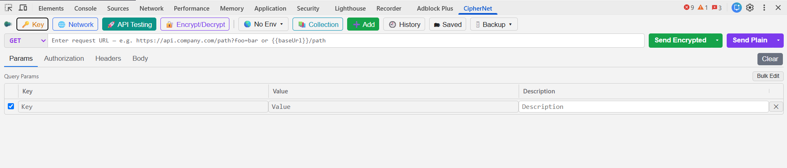

**Version:** 2.19.25 | **Last Modified:** 2026-09-21


# CipherNet (Chrome DevTools extension)

Decrypts CipherNet API **request payloads**, **encrypted query strings**, and
**responses** straight inside Chrome DevTools, so you can read the plaintext
while debugging.


| Setting   | Value                                              |
| --------- | -------------------------------------------------- |
| Algorithm | AES (`Aes.Create()`) → **AES-128-CBC** + **PKCS7** |
| Key       | UTF-8 bytes of your 16-char key (→ AES-128)        |
| IV        | UTF-8 bytes of the same value as the key           |
| Encoding  | **Base64** on the wire                             |

No key is baked into the extension — you enter it in the **🔑 Key** box (it's
saved via `chrome.storage`). The 16-byte key forces AES-128. The extension
decrypts with the Web Crypto API, whose AES-CBC uses PKCS7 padding — identical
to .NET's default — so round-trips match byte-for-byte.

## Installation (Load Unpacked)

Since this extension is not published on the Chrome Web Store, install it in developer mode:

1. Download or clone this repository.
2. Open Chrome and navigate to `chrome://extensions`.
3. Toggle **Developer mode** on (top‑right corner).
4. Click **Load unpacked**.
5. Select the **`CipherNet`** folder (the one containing `manifest.json`) — not the repository root.
6. The **CipherNet** extension will appear in your **Network tab**.
7. For the key: Go to the **Key tab**, select **Load Key File**, and choose the **ciphernet-key.key** file from the repository root.

> On Microsoft Edge, use `edge://extensions` and the same **Load unpacked** flow.

To update after pulling new changes, return to `chrome://extensions` and click the **reload** icon on the CipherNet card.

## Using it (works like the Network tab)

1. **Open it** — DevTools (F12) → the **CipherNet** tab. Capturing starts the instant DevTools opens, so no request is missed.
2. **Set the key** — **🔑 Key** → paste your 16-char AES key → **Save** (auto-closes, persists; 🔑 blinks red until a key is saved). Details: [Key Management](Features.md#key-management).
3. **Browse requests** — the Network view lists every request (**🔒** = encrypted). Click a row for the detail tabs. Details: [Request List](Features.md#request-list) · [Column Management](Features.md#column-management) · [Detail Pane Tabs](Features.md#detail-pane-tabs) · [Decryption](Features.md#decryption).
4. **Filter & search** — filter box mini-language, type pills, **More filters ▾**, and full-text **Search** (Ctrl+F), including decrypted bodies. Details: [Filtering](Features.md#filtering) · [Search](Features.md#search).
5. **Send requests** — **🚀 API Testing**: method + URL, tabs **Params · Authorization · Headers · Body**, then **Send Encrypted** (green) or **Send Plain** (purple). Details: [API Testing Tool](Features.md#api-testing-tool).
6. **Encrypt/decrypt a value** — **🔐 Encrypt/Decrypt**: paste → **Encrypt** (Ctrl+Shift+Enter) / **Decrypt** (Ctrl+Enter); a pasted URL transforms just its query. Details: [Encrypt/Decrypt Tool](Features.md#encryptdecrypt-tool).
7. **Keep things** — save requests into **Collections**, reuse `{{variables}}` from **Environments**, pin responses with 📌, lean on **History** and the file **Backup**. Details: [Collections](Features.md#collections-saved-requests) · [Environments](Features.md#environments-variables) · [Saved Responses](Features.md#saved-responses) · [Request History](Features.md#request-history) · [Backup & Restore](Features.md#backup--restore-collections-history-environments-saved-responses--hide-url-patterns).

**Chrome-style extras** — ● Record / 🗑 clear, Preserve log, Disable cache, Throttling, ⬇ Export (HAR/JSON/CSV/decrypted), resizable splitter, auto light/dark theme. Details: [Network Capture](Features.md#network-capture) · [Network Controls](Features.md#network-controls) · [Export](Features.md#export) · [Layout and Resizing](Features.md#layout-and-resizing) · [Appearance](Features.md#appearance).

## Not yet implemented (from `spec/PRD.md`)

This extension covers capture, a resizable request table (resize/reorder/hide/
persist columns), decryption, the detail tabs above, advanced filtering, search,
export, resizable panes, and the Preserve log / Disable cache / Throttling
controls. Larger PRD items still open:

- Rule engine (configurable per-host decrypt rules, import/export)
- Request interception / edit-and-resend / replay
- Waterfall timeline column; column pinning
- Real bandwidth/latency throttling (Offline works; 5G/4G/3G shaping is blocked
  by the DevTools/debugger limitation above)
- Diff viewer (original vs. decrypted, request A vs. B)
- Import (HAR / previously exported sessions)
- Favorites / tags / notes / colors
- Additional crypto algorithms (AES-GCM, DES, RSA, ECIES, …) + plugin system
- Virtual scrolling / Web Workers for 100k+ requests
- Full TypeScript + React + Vite rewrite

## Files

The panel is built as small ES modules under `src/`, layered core → services →
ui with a single composition root:

| Path                         | Purpose                                              |
| ---------------------------- | ---------------------------------------------------- |
| `manifest.json`              | MV3 manifest, registers the devtools page            |
| `devtools.js`                | Creates the "CipherNet" panel; buffers requests from the moment Inspect mode opens until the panel is first shown |
| `assets/`                    | Extension icons (`icon16/32/48/128.png`, `favicon`)  |
| `panel.html` / `panel.css`   | Panel markup + styles                                |
| `src/main.js`                | Composition root: wires modules, applies settings    |
| `src/core/crypto.js`         | AES-128-CBC decrypt/encrypt (mirrors the backend)    |
| `src/core/format.js`         | Pure formatting / parsing helpers                    |
| `src/core/dom.js`            | Tiny DOM/util primitives (`el`, `copyBtn`, debounce) |
| `src/core/state.js`          | The single mutable app-state store                   |
| `src/core/els.js`            | Cached DOM element references                        |
| `src/services/storage.js`    | Persistence boundary over `chrome.storage.local`     |
| `src/services/capture.js`    | Network capture + response fetch + decryption        |
| `src/services/filters.js`    | Filter engine, resource-type pills, more-filters     |
| `src/services/search.js`     | Global search + in-pane highlighting                 |
| `src/services/exporter.js`   | HAR / JSON / CSV / decrypted-session export          |
| `src/services/networkControls.js` | Preserve log / Disable cache / Throttling       |
| `src/ui/theme.js`            | Auto dark/light theme                                |
| `src/ui/table.js`            | Request list: columns, sort, resize, splitter        |
| `src/ui/detail.js`           | Detail tabs (Headers/Payload/Preview/…)              |
| `src/ui/jsonTable.js`        | Sortable / filterable JSON table (Preview)           |
| `src/ui/views.js`            | Network / API Testing / Encrypt/Decrypt view switcher |
| `src/ui/keyBox.js`           | 🔑 Key box                                           |
| `src/ui/encryptTool.js`      | 🚀 API Testing tool + Send Encrypted/Plain           |
| `src/ui/decryptTool.js`      | 🔐 Encrypt/Decrypt tool (encrypt or decrypt a value)  |
| `selftest.mjs`               | `node selftest.mjs` — verifies crypto vs. .NET       |

## Ship an obfuscated build

Chrome must load plaintext JS, so the source can't be truly *encrypted* — but it
can be **obfuscated** so it's impractical to read. The build runs every shipped
JS file (`devtools.js` plus the whole `src/` ES-module tree) through
[`javascript-obfuscator`](https://github.com/javascript-obfuscator/javascript-obfuscator)
and copies the static assets (manifest, HTML, CSS, icons) verbatim into `dist/`,
preserving the directory layout (`dist/src/…`).

```
npm install      # once, pulls in javascript-obfuscator (dev only)
npm run build    # writes the obfuscated extension to dist/
```

Then **Load unpacked** from the `dist/` folder instead of the project root.

Notes:

- The obfuscator is configured for MV3: `debugProtection`/`selfDefending` are
  **off** (they inject `new Function(...)`, which the MV3 content-security policy
  blocks), and `renameGlobals`/`renameProperties` are **off** so the ES
  `import`/`export` bindings, `chrome.*` APIs and DOM property names keep working.
- Obfuscation raises the bar; it is **not** real protection. Anyone determined
  can still beautify and trace the code, and no secret key is in the extension
  anyway — the AES key is typed in at runtime.

## Pack a signed .crx

To produce a packaged extension — the same thing chrome://extensions
**"Pack extension"** makes — run:

```
npm install      # once
npm run pack     # rebuilds dist/, then writes CipherNet.crx + CipherNet.zip
```

Outputs (in the project root):

| File              | Purpose                                                      |
| ----------------- | ----------------------------------------------------------- |
| `CipherNet.crx`  | Signed **CRX3** package. Drag it onto chrome://extensions.  |
| `CipherNet.zip`  | Plain zip of `dist/` — upload this to the Chrome Web Store. |

`key.pem`, the private signing key, lives **outside this repo** in
`../ciphernet-key/key.pem` — never inside the project folder. Chrome warns
(and Web Store review rejects) unpacked extensions that contain a `.pem` file
alongside the manifest, and this repo's root is exactly the folder you'd
"Load unpacked" for dev, so the key must not sit here. It's generated on the
**first** pack and **reused** afterwards, so the extension ID stays stable
across rebuilds (currently `opdendjleoanbhogiodimdjonpbdokno`).

> ⚠️ **Keep `key.pem` secret and backed up.** Anyone who has it can publish
> updates Chrome treats as this same extension. If you lose it, the extension ID
> changes.

Install notes:

- Drag-installing a `.crx` works in **Developer mode**. For everyday users,
  Chrome only allows installs from the Web Store or via enterprise policy —
  packing a `.crx` does not bypass that.

## Verify the crypto

```
node selftest.mjs
```

It encrypts a sample the .NET way (Node `crypto`, AES-128-CBC) and confirms the
extension's Web Crypto path decrypts it back — proving compatibility.
